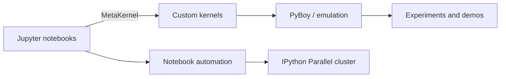

<div align="center">

# 🎮 Google Gaming Ground

**Retro gaming, Jupyter notebooks, and interactive emulation — brought together.**

[](https://www.python.org/)
[](https://jupyter.org/)
[](LICENSE)

</div>

Google Gaming Ground (`g³`) is a modular playground for connecting interactive Jupyter notebooks with retro-game emulation and development tools. The project explores [MetaKernel](https://github.com/Calysto/metakernel) as a gateway between notebooks, custom kernels, and emulators such as [PyBoy](https://github.com/Baekalfen/PyBoy).

## ✨ What’s inside

- **Interactive notebooks** for experiments and demos.
- **Custom MetaKernels** for trying out specialized execution and data flows.
- **Emulation experiments** that bring Game Boy projects into notebook workflows.
- **Automation scripts** for starting a local cluster and running notebooks in batch.

## 🏗️ How it fits together



## 🚀 Quick start

### Requirements

- Git
- [Poetry](https://python-poetry.org/)

### Set up

```bash
git clone https://github.com/M4tth4ck333/google-gaming-ground.git
cd google-gaming-ground
poetry sync --with test-all
```

### Run the notebook workflow

```bash
bash scripts/run_notebooks.sh
```

The script is intended to start the IPython cluster and run the project’s test notebooks. Check the `scripts/` directory for the available automation scripts.

## 📂 Project structure

| Path | Description |
| --- | --- |
| `examples/` | Interactive notebooks and demos |
| `metakernel_python/` | Python MetaKernel connector |
| `metakernel_echo/` | Echo kernel for testing and debugging |
| `scripts/` | Cluster and notebook automation scripts |

## 🧩 Using MetaKernel

A custom kernel can extend `MetaKernel`. This minimal example is a starting point; add the project-specific execution and emulation logic where indicated:

```python
from metakernel import MetaKernel


class CustomGamingKernel(MetaKernel):
    implementation = "Google Gaming Ground Kernel"
    language = "python"

    # Add custom commands and emulation integration here.
```

## 📜 License

This project is licensed under the MIT License. See [`LICENSE`](LICENSE) for details.
